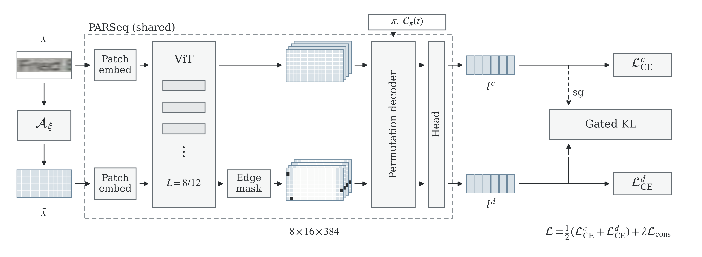

<div align="center">

# PARSeq-BADT

### Boundary-Aware Degradation Training for Scene Text Recognition

[Method](#method) · [Models and Results](#models-and-results) · [Installation](#installation) · [Dataset Preparation](#dataset-preparation) · [Evaluation](#evaluation) · [Training](#training)

</div>

BADT (Boundary-Aware Degradation Training) is a training method for scene text recognition built on [PARSeq](https://github.com/baudm/parseq). It combines dual-view supervision, boundary feature perturbation, and gated consistency learning to recognize text affected by blur, low resolution, and boundary clutter. Inference uses a single PARSeq forward path.

<p align="center">
  
</p>

## Method

- **Dual-view training:** The base and degraded views are processed by the same PARSeq model with shared parameters. Both views are supervised with ground-truth labels.
- **Boundary-aware perturbation:** Image degradations are combined with random zeroing of visual tokens along the left and right boundaries in the degraded branch.
- **Gated consistency learning:** Correct predictions from the base branch that meet a confidence threshold guide the degraded branch through KL divergence. Gradients are stopped through the reference targets.

## Models and Results

| Model | Encoder | Input Size | Download |
| :--- | :---: | :---: | :---: |
| BADT | ViT8 | 32 × 128 | [badt_vit8_best.ckpt](https://github.com/haogch99-pixel/PARSeq-BADT/blob/main/checkpoints/badt_vit8_best.ckpt) |

### Benchmark Results

| Protocol | Samples | Accuracy (%) | 1 − NED (%) |
| :--- | ---: | ---: | ---: |
| Subset | 7,248 | **96.29** | **98.95** |
| Full | 7,672 | **95.74** | **98.70** |

## Installation

Use Python 3.10. Install [Git LFS](https://git-lfs.com/) before cloning the repository and downloading the model:

```bash
git lfs install
git clone https://github.com/haogch99-pixel/PARSeq-BADT.git
cd PARSeq-BADT
git lfs pull
```

Install the dependencies:

```bash
python -m pip install -r requirements/core.txt
python -m pip install -r requirements/train.txt -r requirements/test.txt
python -m pip install -e .
```

The requirements install the CPU build of PyTorch by default. For an NVIDIA GPU, switch to the CUDA 12.1 build:

```bash
python -m pip install torch==2.2.1+cu121 torchvision==0.17.1+cu121 --index-url https://download.pytorch.org/whl/cu121
```

For other platforms, see the [PyTorch installation instructions](https://pytorch.org/get-started/previous-versions/#v221).

## Dataset Preparation

**Download: [Baidu Netdisk](https://pan.baidu.com/s/17zaFLCDms0-8uzSZ2jqnFQ?pwd=c7qs) · Access code: `c7qs`**

Extract the LMDB datasets into `data/` at the repository root. Each leaf dataset directory should contain a `data.mdb` file.

```text
data/
├── train/
│   └── real/
│       ├── ArT/
│       ├── COCOv2.0/
│       ├── LSVT/
│       ├── MLT19/
│       ├── OpenVINO/
│       │   ├── train_1/
│       │   ├── train_2/
│       │   ├── train_5/
│       │   ├── train_f/
│       │   └── validation/
│       ├── RCTW17/
│       ├── ReCTS/
│       ├── TextOCR/
│       └── Uber/
├── val/
│   ├── IC13/
│   ├── IC15/
│   ├── IIIT5k/
│   └── SVT/
└── test/
    ├── CUTE80/
    ├── IC13_857/
    ├── IC13_1015/
    ├── IC15_1811/
    ├── IC15_2077/
    ├── IIIT5k/
    ├── SVT/
    └── SVTP/
```

## Evaluation

```bash
python test.py checkpoints/badt_vit8_best.ckpt \
  --data_root data \
  --device cuda \
  --output_dir results
```

For CPU evaluation, replace `--device cuda` with `--device cpu`. Evaluation uses lowercase alphanumeric characters by default. Add `--cased --punctuation` for case-sensitive evaluation with punctuation.

## Training

```bash
python train.py +experiment=parseq-badt-vit8 \
  data.root_dir=data \
  trainer.accelerator=gpu \
  trainer.devices=1
```

